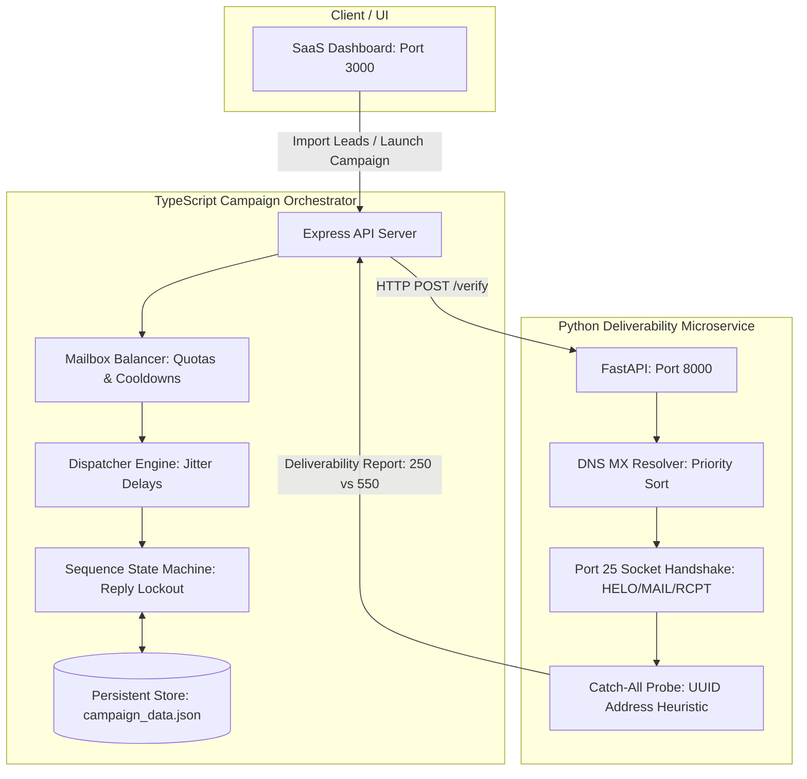

# ⚡ OutreachEngine

> High-throughput Cold Outreach Infrastructure & Real-Time SMTP Verification Engine built with a **Polyglot Architecture** (Python + TypeScript).

[](https://nodejs.org/)
[](https://www.python.org/)
[](https://fastapi.tiangolo.com/)
[](https://www.typescriptlang.org/)
[](https://opensource.org/licenses/MIT)

---

## 📌 Problem Statement

Modern sales outreach platforms like **Instantly.ai** and **Smartlead.ai** operate in an increasingly strict email deliverability landscape:
1. **Google & Yahoo 2024 Bulk Sender Mandates**: Senders exceeding a **0.3% spam complaint threshold** or a **2% bounce rate** face immediate domain reputation degradation and bulk blacklisting.
2. **Catch-All Domain Traps**: Over 35% of corporate domains (Google Workspace, Microsoft 365) return `250 OK` for nonexistent inboxes, deceiving standard email syntax cleaners and causing silent deliverability drops.
3. **Robotic Sending Patterns**: Blasting emails at fixed time intervals from a single inbox triggers automated heuristic spam filters.

**OutreachEngine** tackles these challenges with a decoupled, polyglot architecture:
* A low-level **Python verification microservice** that validates mailboxes on Port 25 without sending an email.
* A high-concurrency **TypeScript campaign orchestrator** featuring multi-mailbox quota balancing, human entropy jitter, and an immutable sequence state machine.

---

## 🏗️ System Architecture



---

## 🚀 Key Engineering Pillars

### 1. Real-Time Socket Verification (Python Microservice)
* **Zero-Send Verification**: Connects directly to the primary MX server on **Port 25**, executes `HELO` $\rightarrow$ `MAIL FROM` $\rightarrow$ `RCPT TO`, and captures server status codes (`250 OK` vs `550 User Unknown`) before sending `RSET`/`QUIT`.
* **Catch-All Domain Heuristic**: Probes randomized UUID test addresses to determine whether the domain accepts all emails, accurately classifying addresses as `VALID` vs `RISKY_CATCH_ALL`.
* **Short-Circuit Evaluation**: Fails fast locally on invalid RFC syntax (0 network overhead) or missing MX records (0 socket connections).

### 2. Multi-Mailbox Pool Balancer (TypeScript)
* **Two-Tier Load Balancing**: Rotates sending accounts using a primary metric of **lowest daily volume** and a secondary tie-breaker of **longest idle cooldown**.
* **Safety Thresholds**: Strictly enforces individual daily caps (e.g. max 30 emails/day) and minimum cooldown periods (e.g. 300s) to prevent mailbox burn.

### 3. Campaign Sequence State Machine (TypeScript)
* **Immutable State Progression**: Functional state transitions (`PENDING` $\rightarrow$ `STEP_1_SENT` $\rightarrow$ `COMPLETED`) preventing race conditions.
* **Instant Reply Lockout**: Inbound reply webhooks immediately lock leads into `REPLIED`, permanently aborting any scheduled follow-up steps.

### 4. Human Entropy Jitter Dispatcher
* **Randomized Sending Intervals**: Injects randomized delays (e.g. 180s–360s in production) between dispatches to defeat bot-detection heuristics.

---

## 🛠️ Quickstart Guide

### Prerequisites
* Python 3.10+
* Node.js 18+

### 1. Start Deliverability Microservice
```powershell
cd verifier-service
pip install -r requirements.txt
python -m uvicorn main:app --port 8000
```
*Interactive Swagger docs available at: `http://localhost:8000/docs`*

### 2. Start Campaign Orchestrator
```powershell
cd orchestrator-service
npm install
npx tsx src/server.ts
```

### 3. Open Web Dashboard
Navigate to **`http://localhost:3000`** to access the live dashboard.

---

## 🗺️ Roadmap & In-Development Features

- [x] Live Port 25 SMTP handshake & DNS MX resolver
- [x] Catch-all domain probe heuristic
- [x] Multi-mailbox quota and cooldown balancer
- [x] Sequence state machine with instant reply-lockout
- [x] Persistent database store (`campaign_data.json`)
- [x] Interactive dark-mode dashboard
- [ ] **Sender Domain Health Check**: Automated pre-flight inspection of SPF, DKIM, and DMARC DNS records.
- [ ] **AI Icebreaker Personalizer**: LLM pipeline generating contextual opening lines based on prospect company & role.
- [ ] **Model Context Protocol (MCP) Server**: Exposing tools (`verify_lead`, `launch_outreach`) to Claude Desktop and Cursor AI agents.

---

## 📄 License
MIT License.
